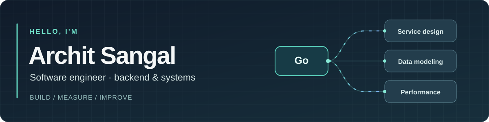

  

   

  **I like building the parts of a product you don't see—then making them faster, clearer, and more dependable.**

  [LinkedIn](https://www.linkedin.com/in/architsangal/) · [X](https://x.com/ArchitSangal_) · [Email](mailto:architsangal2000@gmail.com)

### Where I focus

`Go` · `gRPC` · `Backend architecture` · `APIs` · `MongoDB` · `MySQL` · `Performance`

I enjoy designing service boundaries, thinking through data models, and following a slow request all the way to its cause. I also work with AWS, Docker, and Kubernetes. This space is for my own projects, experiments, and what I learn while building them.

### On my workbench

**[AteThat](https://github.com/architsangal/AteThat)** — a nutrition and health-tracking app that I'm actively building. Its backend uses a Go API, a Go gRPC core, and MongoDB, with a React/TypeScript interface. It's locally runnable, not a production deployment. The [architecture notes](https://github.com/architsangal/AteThat/blob/main/docs/ARCHITECTURE_VISUAL_SUMMARY.md) and [pull requests](https://github.com/architsangal/AteThat/pulls?q=is%3Apr) show where it's heading and how it's changing.

Still in motion: I'll update this profile as the project grows.

### Other things I've built

- **[MongoDB graph analytics library](https://github.com/architsangal/MongoDB-based-Graph-Algorithm-and-Analytics-Library)** — graph representation and analysis with MongoDB and JavaScript, including connected components and graph-minor operations.
- **[FoodFast](https://github.com/architsangal/foodfast)** — a Flutter/Firebase canteen app I built and led during college, mentoring two students through IIITB Summer of Code.

  Curiosity → prototype → measure → improve.

